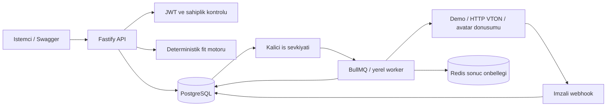
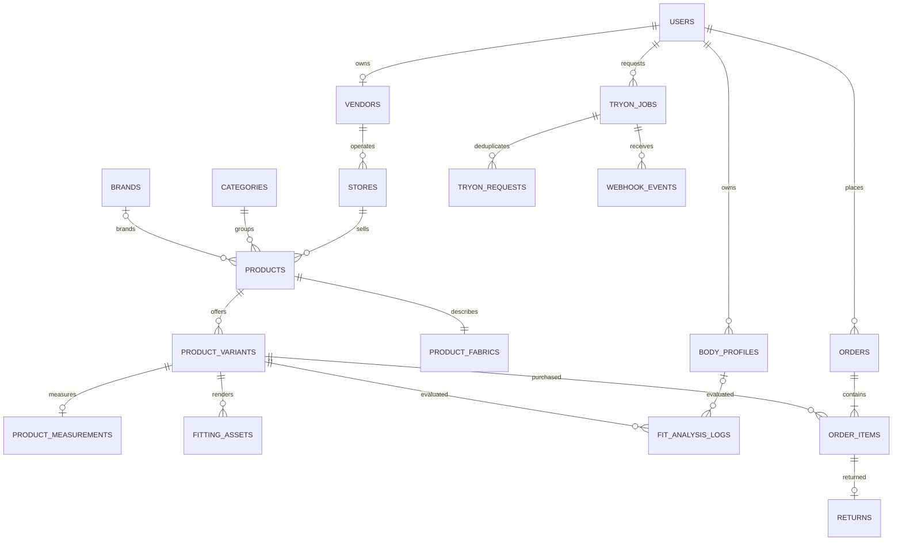
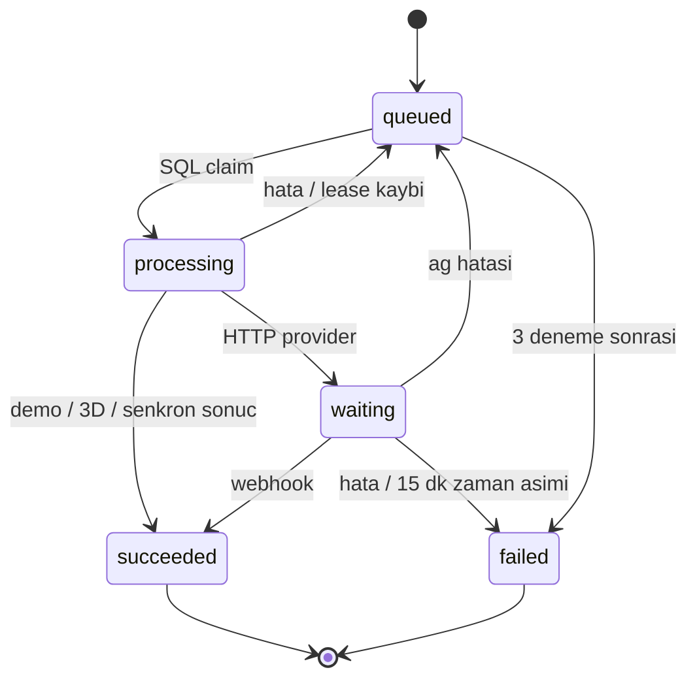

# Backend mimarisi

## Servis yapisi

API, uyum motoru, prova worker'i ve siparis servisi moduler bir uygulamadir. Yerelde ayni surecte calisir. Uretimde API'nin birden fazla kopyasi ayni PostgreSQL ve Redis'i kullanabilir; kosullu SQL durum gecisleri ayni prova isinin iki worker tarafindan sahiplenilmesini engeller. PostgreSQL kalici is kaynagidir. BullMQ sevkiyat ve eszamanlilik, Redis sonuc onbellegi icindir.



## Veri kurallari

- Vucut ve urun olculeri cm; agirlik kg. Avatar katmani metre kullanir. `chest`, `waist`, `hips` urunlerde de CEVRE olcusudur. Duz zeminde olculen bel/genislik cevreye girilmeden once ikiyle carpilir. `hemWidth` tek tarafli duz genisliktir.
- Olculer, DB CHECK ve API sinirlariyla dogrulanir. `outseam >= inseam` ve `outseam <= height` gerekir. Eksik urun olculeri null kalir; sifir veya tahmini mukemmel skorla doldurulmaz.
- Kumas yuzdeleri toplam 100 olmalidir. Esneme katsayisi olculmus mekanik esneme oranidir; `%2 elastan` otomatik `%2 esneme` olarak kabul edilmez. `elasticitySource` veri kaynagini tutar.
- Para integer kurus/minor unit olarak saklanir. Komisyon basis point cinsindedir: 1500 = %15. Sipariste fiyat, SKU, beden, komisyon ve istege bagli vucut/urun/fit anlik goruntuleri sabitlenir.
- Profil revision ve urun olcu revision degisimleri prova onbellek anahtarini degistirir. Stok render sonucunu degistirmedigi icin render snapshot'unda sifirlanir. Kimlikler UUID; iliskiler FK ile korunur.
- Varsayilan profil icin kullanici basina tek kayit kismi unique index ile korunur. Yeni profil varsayilan secilmek zorunda degildir. Kullanici birden fazla profil saklayabilir.
- Aktif urun, aktif magaza, aktif varyant ve stok sartlari feed/siparis kontrolunde uygulanir. Feed ic bacak ve bel icin tasarlandigindan yalniz `bottom` urunleri tarar. Top/dress icin ayri olcu politikalari fit-check'te vardir.
- `store_metrics` iadesi tamamlanan kalemler icin materialize metrik tablosudur; mevcut endpoint teslim edilen kalemler ve ACILAN iade TALEPLERINI kaynak tablolardan hesaplar. Talep orani ile kesinlesen para iadesi orani birbirine karistirilmaz.

## Iliskiler



## Uyum algoritmasi

`calculateFitScore(body, selectedMeasurement, elasticityRatio, alternatives, garmentType, cut)` senkron ve deterministiktir. DB veya saglayici cagrisi yapmaz. Alt giyimde agirliklar bel %35, basen %40, ic bacak %25; ust giyimde gogus %80, omuz %20; elbisede gogus %35, bel %30, basen %35'tir.

Slim/regular/relaxed kesimler farkli pozitif bolluk payi hedefleri kullanir. Rahat esneme kapasitesi urun cevresi x olculmus esneme x 0.6'dan hesaplanir. Fiziksel darlik, esneme sinirini asan kisim, fazla bolluk ve hedef bolluk eksigi farkli ceza alir. Esneme bacak boyu veya omuz genisligini uzatmaz. Bacakta +-2 cm, omuzda +-1 cm tolere edilir. Belirgin darlik/kisa bacak toplam skoru en fazla 69 yapar; diger bolgeler bu sorunu ortemez.

Beden onerisi ayni urunun ayni rengindeki stoklu, tam olculu varyantlar arasindan yapilir. Hicbir aday 70'e ulasmiyorsa onerilen beden null olur. Skor klinik veya istatistiksel olasilik degildir. Mevcut katsayilar versiyonlu bir baslangic politikasidir; iade verisi ve fiziksel prova calismalariyla kalibre edilmelidir.

Feed once DB'de genis bel ve bacak araliginda adaylari eler; sonra ayni fit motoruyla toplam skor, bel skoru ve ic bacak skoru >=90 sarti uygular. Kimlik sirali keyset pagination kullanir; her istekte en fazla 200 aday analiz edilir. Bos sayfa ve dolu `nextCursor` olabilir: istemci sonraki sayfayi istemelidir. Sonuclar global skor sirasinda degil, sabit varyant kimligi sirasindadir.

## Prova durum makinesi



API is satirini ve varsa idempotency bagini tek DB transaction'inda olusturur. 500 ms aralikli dispatcher queued satirlari yayinlar; API ile Redis arasinda is kaybi olusmaz. SQL claim yalniz queued durumda basarili olur. Ag hatalari en fazla 3 deneme ve ustel gecikmeyle tekrar edilir. 2 dakika guncellenmeyen processing lease'i kurtarilir; 15 dakika bekleyen async is failed olur. Saglayici ayni DB job UUID'sini idempotency anahtari olarak kabul etmelidir; aksi halde timeout tekrarinda birden fazla fatura/uretim olusabilir.

Onbellek SHA-256 anahtari kullanici kimligi, profil kimligi/revision'i, olculer, varyant, asset checksum/revision, model surumu ve UTC gunu uzerinden hesaplanir. Paylasilan kullanicilar arasi onbellek yoktur. Sonuclar gun sonunda sona erer; yeni gunde yeni render isi acilir. Eski is durumu DB'de izlenebilir. Redis bozulmasinda DB sonucuna donulur. Onbellek sonuc okumalarindan once DB sahipligi kontrol edilir. Basarisiz gunluk is otomatik yeni render acmaz; ertesi gun yeni anahtar veya model/olcu degisikligi gerekir.

`Idempotency-Key` try-on icin istege bagli, siparis icin zorunludur; 8-128 karakterdir. Tekrar ayni istegin ayni isi/siparisi doner. Ayni anahtarla farkli snapshot 409 verir. Try-on icin birden fazla anahtar tek cache hit isine baglanabilir; anahtar baglari ayri tabloda saklanir.

## HTTP VTON adapter sozlesmesi

`TRYON_PROVIDER=http`, `VTON_ENDPOINT`, `VTON_API_KEY`, `WEBHOOK_SECRET`, `RESULT_HOSTS` gerekir. Uygulama asagidaki istegi endpoint'e POST eder. 30 saniye HTTP timeout, HTTPS ve redirect engeli uygulanir. Saglayici baz manken katalog kimligini gercek gorsele donusturur; burada bulunan dort baz vektor yalniz secim politikasinin demo katalogudur.

```http
Authorization: Bearer PROVIDER_API_KEY
Idempotency-Key: DATABASE_JOB_UUID
Content-Type: application/json
```

```json
{
  "clientJobId": "DATABASE_JOB_UUID",
  "callbackUrl": "https://api.example.com/api/v1/webhooks/vton",
  "baselineId": "pear-medium",
  "input": {
    "mode": "ai",
    "body": { "height": 172, "weight": 68, "chest": 94, "waist": 76, "hips": 100, "inseam": 78, "outseam": 102, "shoulderWidth": 40, "bodyShapeType": "pear" },
    "profileRevision": 1,
    "garmentType": "bottom",
    "measurement": { "variantId": "VARYANT_UUID", "size": "M", "stock": 0, "waist": 78, "hips": 104, "chest": 100, "inseam": 78, "outseam": 104, "totalLength": 105, "hemWidth": 18, "shoulderWidth": 40 },
    "elasticityRatio": 0.04,
    "assets": [{ "type": "front", "url": "https://assets.example.com/front.png", "sha256": "64_HEX_CHARACTERS", "revision": 1 }],
    "modelVersion": "http-provider-v1"
  },
  "avatar": { "units": "meters", "model": "parametric-v1", "height": 1.72, "chestCircumference": 0.94, "waistCircumference": 0.76, "hipCircumference": 1, "inseam": 0.78, "outseam": 1.02, "shoulderWidth": 0.4, "bodyShapeType": "pear", "massKg": 68, "requiresCalibration": true, "smplxBetas": null }
}
```

Senkron cevap:

```json
{ "status": "completed", "imageUrl": "https://cdn.example.com/render.png" }
```

Asenkron cevap:

```json
{ "status": "pending", "providerJobId": "provider-123" }
```

Callback JSON ham govdesi imzalanir. Basliklar `x-vton-timestamp` (Unix saniye) ve `x-vton-signature` (hex HMAC-SHA256) olmalidir. Imza girdisi `timestamp + "." + rawBody`'dir. Kabul penceresi +-5 dakika; ham govde JSON parse'dan once korunur. `eventId` unique tabloyla tekrar olaylar engellenir. Ilk dogrulanmis terminal sonuc kalicidir; gec gelen hata basarili sonucu bozmaz.

```json
{
  "eventId": "provider-event-123",
  "jobId": "DATABASE_JOB_UUID",
  "status": "succeeded",
  "imageUrl": "https://cdn.example.com/render.png"
}
```

```ts
import { createHmac } from 'node:crypto';
const timestamp = Math.floor(Date.now() / 1000).toString();
const rawBody = JSON.stringify(payload);
const signature = createHmac('sha256', webhookSecret)
  .update(timestamp + '.').update(rawBody).digest('hex');
```

Sonuc adresleri yalniz `RESULT_HOSTS` icindeki HTTPS hostname'lerinden kabul edilir. Bu backend uzak sonucu indirmez. Uretim adapter'i sonucu kendi obje deposuna kopyalamali, URL erisimini ve saklama suresini is expiry'siyle uyumlu tutmalidir. Demo URL'leri gercek VTON girdisi icin uygun degildir.

## Parametrik 3D katmani

`bodyToAvatar` vucut olculerini metre cinsinden formatlar. GLB/glTF asset varsa ona referans verir. Olcu -> SMPL-X beta donusumu bire bir analitik esitlik degildir; kalibre edilmis optimizasyon, lisansli model dosyalari ve geometri gerekir. Bu nedenle `smplxBetas: null`, `requiresCalibration: true`, `simulationStatus: parameters_only` acikca doner. Ready Player Me entegrasyonu da ayri mesh morph/calibration adapter'i ister. Fiziksel kumas icin esneme oranindan fazlasina (warp/weft, bending, damping, kalinlik, agirlik, dikis ve collision) ihtiyac vardir.

## Siparis ve iade

Siparis olusturma fiyati istemciden kabul etmez. Varyantlar UUID sirasiyla kilitlenir; stok `stock >= quantity` kosullu decrement ile dusulur. Tum kalemler ve fiyat snapshot'i ayni transaction'dadir. Herhangi bir kalemde hata tum islemi geri alir. Ayni idempotency anahtariyla eszamanli iki islemden unique index kaybedeni geri alir ve mevcut siparisi okur.

Odeme bekleyen rezervasyon 15 dakika sonra veya kullanici iptaliyle cozulur. Kosullu durum gecisi stok eklemesini tek kez yapar. Demo yonetici `pending_payment -> paid -> shipped -> delivered` gecislerini deneyebilir. Uretim paid gecisini reddeder; odeme webhook adapter'i uygulanmalidir. Iade yalniz siparis sahibi ve delivered kalem icin acilir; mevcut akis tam siparis kalemi icindir. Bir kalem icin bir talep vardir; kismi miktar iadesi sonraki gelistirmedir.

Profil silindiginde bagli prova girdileri ve fit loglari silinir. Satin alinmis siparis snapshot'lari iade incelemesi icin korunur. Gercek ortamda veritabani ve obje deposu erisim politikasi, saklama sureleri ve silme gorevleri bu alanlara gore yapilandirilmalidir. Loglar vucut olculerini ve parola/JWT'yi yazmaz.

## Resmi basvuru kaynaklari

- [Drizzle PGlite adapter'i](https://orm.drizzle.team/docs/get-started/pglite-existing)
- [Drizzle SQL migration yaklasimi](https://orm.drizzle.team/docs/migrations)
- [BullMQ idempotent job tasarimi](https://docs.bullmq.io/patterns/idempotent-jobs)
- [BullMQ job kimlikleri](https://docs.bullmq.io/guide/jobs/job-ids)
- [Fastify Swagger entegrasyonu](https://github.com/fastify/fastify-swagger)
